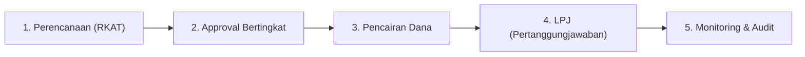

# 🌟 Sistem Informasi RKAT Kampus (ReKAT) 📊

[](https://laravel.com)
[](https://reactjs.org/)
[](https://inertiajs.com/)
[](https://tailwindcss.com/)
[](https://vitejs.dev/)
[](https://php.net)

**Sistem Informasi RKAT Kampus (ReKAT)** adalah platform manajemen perencanaan, penganggaran, pencairan dana, dan pelaporan pertanggungjawaban kegiatan tahunan berbasis web modern. Dibangun menggunakan arsitektur **Laravel 12** monolitik modern dengan **Inertia.js 2.0** dan **React 18**, sistem ini menghadirkan pengalaman pengguna sekelas *Single Page Application (SPA)* tanpa mengorbankan keamanan dan ketangguhan backend Laravel.

Sistem dirancang khusus untuk memenuhi standar tata kelola perguruan tinggi yang menuntut akuntabilitas keuangan ketat, pelacakan Indikator Kinerja Utama (IKU/IKK), verifikasi berjenjang multi-level, serta siklus anggaran tertutup (*closed-loop budget cycle*).

---

## 📑 Daftar Isi

- [Arsitektur Siklus Anggaran](#-arsitektur-siklus-anggaran)
- [Modul & Fitur Utama](#-modul--fitur-utama)
- [Fitur Antarmuka & UX Terkini](#-fitur-antarmuka--ux-terkini)
- [Tech Stack](#-tech-stack)
- [Prasyarat Lingkungan](#-prasyarat-lingkungan)
- [Panduan Instalasi & Setup Lokal](#-panduan-instalasi--setup-lokal)
- [Skema Data Inti (Database Architecture)](#-skema-data-inti-database-architecture)
- [Struktur Direktori Proyek](#-struktur-direktori-proyek)
- [Daftar Peran & Hak Akses (RBAC)](#-daftar-peran--hak-akses-rbac)
- [Tim Pengembang](#-tim-pengembang)

---

## 🔄 Arsitektur Siklus Anggaran

Sistem ReKAT mengelola 4 fase utama anggaran secara terintegrasi:



1. **Perencanaan (RKAT):** Unit kerja menyusun usulan program, indikator kinerja (IKU/IKK), target capaian, dan Rincian Anggaran Belanja (RAB multi-volume).
2. **Approval Bertingkat:** Dokumen ditinjau berjenjang sesuai rute persetujuan unit (*Approval Path*), dari Kepala Unit, Tim Renbang, hingga Pimpinan/Wakil Rektor.
3. **Pencairan Dana:** Unit mengajukan pencairan bertahap atas RKAT yang telah disetujui final dengan validasi batas pagu dan sisa volume.
4. **Pertanggungjawaban (LPJ):** Pelaporan realisasi belanja disertai unggah kuitansi/nota sah serta kalkulasi otomatis sisa dana yang harus dikembalikan ke kas kampus.
5. **Monitoring & Evaluasi:** Dashboard analitik dan grafik serapan anggaran real-time per unit, status pengajuan, serta capaian target IKU/IKK.

---

## 🚀 Modul & Fitur Utama

### 1. 📋 Modul Pengajuan RKAT
- **Header-Detail Kegiatan:** Satu dokumen pengajuan dapat menampung latar belakang, tujuan, mekanisme, lokasi, dan jadwal pelaksanaan.
- **Indikator Kinerja Kegiatan:** Pemetaan ketercapaian target multi-tahun (*baseline past*, *target current*, *target future*).
- **RAB Fleksibel (Dua Dimensi Volume):** Input rincian biaya dengan dukungan Volume 1 dan Volume 2 (contoh: *10 Orang x 3 Hari*).
- **Standar Biaya Operasional (SBO):** Integrasi langsung ke master tarif pagu akun belanja untuk mencegah markup biaya.
- **Lampiran Pendukung:** Dukungan unggah berkas (PDF, Word, Excel, Gambar hingga 10MB) serta tautan dokumen Google Drive.
- **Export Dokumen:** Cetak dokumen usulan RKAT resmi ke format PDF standar institusi.

### 2. ⚡ Modul Approval & Workflow Dinamis
- **Jalur Persetujuan Khusus Unit:** Konfigurasi rute approval yang dinamis per unit kerja (melalui menu *Approval Path*).
- **Aksi Review Lengkap:** Penyetuju dapat memberikan aksi *Setujui*, *Revisi (dengan catatan revisi)*, atau *Tolak*.
- **Pencegahan Self-Approval:** Logika sistem otomatis mencegah pengaju menyetujui pengajuannya sendiri.
- **Log Audit Lengkap:** Setiap perubahan status, komentar verifikator, dan waktu aksi tercatat permanen di riwayat log.

### 3. 💸 Modul Pencairan Dana
- **Pencairan Bertahap:** Mengambil referensi dari RKAT yang berstatus *Disetujui Final*.
- **Validasi Plafon Real-Time:** Menghitung otomatis akumulasi pencairan sebelumnya agar tidak melebihi sisa volume dan total pagu yang disetujui.
- **Approval Pencairan Khusus:** Alur verifikasi keuangan tersendiri sebelum dana dicairkan oleh bagian keuangan/BPUK.
- **Kwitansi & Export PDF:** Pembuatan tanda bukti pengajuan pencairan dana siap cetak.

### 4. 🧾 Modul Laporan Pertanggungjawaban (LPJ)
- **Pelaporan Realisasi Item:** Input realisasi riil dari setiap item pencairan dana yang telah diterima.
- **Manajemen Sisa Dana:** Kalkulasi otomatis selisih lebih/kurang bayar untuk pengembalian sisa dana ke bendahara.
- **Bukti Transaksi Digital:** Unggah berkas kuitansi, nota, foto kegiatan, dan bukti transfer.
- **Approval LPJ:** Verifikasi kelayakan bukti belanja oleh verifikator keuangan sebelum status ditutup (*Closed/Final*).

### 5. 📈 Modul Monitoring & Dashboard
- **Metrik Finansial:** Rekapitulasi total anggaran diajukan, disetujui, dicairkan, dan sisa pagu.
- **Grafik Interaktif (Recharts):** Visualisasi serapan dana per bulan, komparasi per unit, dan status distribusi pengajuan.
- **Pelacakan Target IKU & IKK:** Matriks capaian indikator kinerja institusi berdasarkan kegiatan yang berjalan.

### 6. ⚙️ Modul Administrasi Master Data (Super Admin)
- **Manajemen Pengguna:** Pengelolaan akun, penugasan unit kerja, dan pengaturan peran (*Role-Based Access Control*).
- **Manajemen Unit Kerja:** Pengaturan struktur hierarki biro, fakultas, prodi, dan lembaga.
- **Master IKU & IKK:** Pengelolaan indikator tahunan, duplikasi indikator lintas tahun anggaran (*copy from previous year*).
- **Master SBO (Standar Biaya):** Registrasi kode akun belanja dan batas tarif acuan.
- **Tahun Anggaran & Penguncian Sistem:** Kontrol pembukaan dan penutupan periode pengajuan anggaran (*Lock/Unlock System*).

---

## 🎨 Fitur Antarmuka & UX Terkini

- **Resizable Columns (Drag & Drop):** Seluruh tabel utama mendukung pengubahan lebar kolom interaktif dengan kursor/sentuhan jari dan otomatis tersimpan di `localStorage`.
- **Protected Click Sorting:** Klik tombol urutkan data (*sorting*) terfokus pada nama kolom agar tidak memicu konflik saat pengguna me-resize kolom.
- **Touchscreen Friendly:** Pengoptimalan area sentuh (hit-area) resizer tabel hingga 20px pada perangkat mobile dan tablet.
- **Floating Mobile Notification Center:** Pusat notifikasi responsif dengan modal adaptif di mobile dan popover elegan di desktop.
- **Dark Mode & Light Mode:** Dukungan tema gelap/terang otomatis tersinkronisasi dengan preferensi sistem operasi dan penyimpanan lokal.
- **Toast Feedback (Sonner):** Notifikasi pop-up modern dan non-intrusif untuk setiap keberhasilan atau kegagalan aksi.
- **Export to Excel & PDF:** Konversi data tabel ke lembar kerja Excel (`.xlsx`) secara instan di sisi klien.

---

## 💻 Tech Stack

### Backend
- **Framework:** Laravel 12.0
- **Bahasa:** PHP ^8.2
- **Autentikasi & Scaffolding:** Laravel Breeze (Inertia Stack)
- **PDF Engine:** Barryvdh Laravel DomPDF
- **Database:** MySQL / MariaDB

### Frontend
- **Library:** React 18.2
- **Bridge:** Inertia.js 2.0 (React Adapter)
- **Build Tool:** Vite 7.0
- **Styling:** Tailwind CSS 3.2, Tailwind Merge, Tailwind Animate
- **Komponen UI:** Radix UI Primitives, Lucide Icons
- **Visualisasi Data:** Recharts
- **Spreadsheet Engine:** SheetJS (XLSX)

---

## 📦 Prasyarat Lingkungan

Pastikan server atau komputer lokal Anda telah terinstal:
- **PHP** `>= 8.2` (dengan ekstensi: `bcmath`, `ctype`, `fileinfo`, `json`, `mbstring`, `openssl`, `pdo_mysql`, `tokenizer`, `xml`, `gd`)
- **Composer** `>= 2.5`
- **Node.js** `>= 18.x` dan **NPM** `>= 9.x`
- **MySQL** `>= 8.0` atau **MariaDB** `>= 10.4`

---

## 🔧 Panduan Instalasi & Setup Lokal

Ikuti tahapan instalasi berikut langkah demi langkah:

### 1. Kloning Repositori
```bash
git clone https://github.com/rkat-tsu/frontend-rkat.git sistem-rkat
cd sistem-rkat
```

### 2. Instalasi Dependensi Backend (PHP)
```bash
composer install
```

### 3. Konfigurasi File Environment
Salin template konfigurasi `.env.example`:
```bash
cp .env.example .env
```
Buka file `.env` dan sesuaikan koneksi database:
```env
DB_CONNECTION=mysql
DB_HOST=127.0.0.1
DB_PORT=3306
DB_DATABASE=db_rkat
DB_USERNAME=root
DB_PASSWORD=
```

Generate kunci aplikasi:
```bash
php artisan key:generate
```

### 4. Migrasi & Seeder Database
Jalankan migrasi tabel beserta data awal:
```bash
php artisan migrate --seed
```
> *(Gunakan `php artisan migrate:fresh --seed` jika ingin mereset ulang seluruh data database)*

### 5. Buat Symbolic Link Storage
Pastikan file lampiran dan bukti kuitansi dapat diakses:
```bash
php artisan storage:link
```

### 6. Instalasi Dependensi Frontend & Kompilasi Aset
```bash
npm install
npm run build
```

### 7. Menjalankan Server Pengembangan (Lokal)
Jalankan server backend dan Vite dev server secara bersamaan:

**Terminal 1 (Backend Laravel):**
```bash
php artisan serve
```

**Terminal 2 (Frontend Vite HMR):**
```bash
npm run dev
```

Buka peramban Anda di: **`http://127.0.0.1:8000`**

---

## 🗄️ Skema Data Inti (Database Architecture)

| Nama Tabel | Peran & Deskripsi Entitas | Relasi Kunci |
| :--- | :--- | :--- |
| `penggunas` | Master akun pengguna, kredensial, peran, dan unit kerja asal. | `id_unit` -> `units.id_unit` |
| `units` | Master unit kerja (Biro, Fakultas, Prodi, Lembaga) dan hierarkinya. | Self-referencing `parent_id` |
| `tahun_anggarans` | Periode anggaran tahunan, rentang tanggal buka/tutup, status kunci. | Primary Key: `tahun_anggaran` |
| `rkat_headers` | Header pengajuan dokumen usulan RKAT dan status verifikasi final. | `id_unit`, `diajukan_oleh`, `tahun_anggaran` |
| `rkat_details` | Rincian kegiatan, tujuan, mekanisme, lokasi, dan jadwal pelaksanaan. | `id_header` -> `rkat_headers.id_header` |
| `indikator_kinerjas` | Matriks indikator capaian target program (past, current, future). | `rkat_detail_id` -> `rkat_details.id` |
| `rkat_rab_items` | Rincian anggaran biaya item per kegiatan (volume 1 & 2, tarif SBO). | `rkat_detail_id`, `kode_akun` |
| `pencairan_danas` | Transaksi penarikan dana bertahap dari RKAT yang telah disetujui. | `id_header`, `diajukan_oleh` |
| `lpjs` | Laporan pertanggungjawaban realisasi belanja dan sisa pengembalian. | `id_pencairan`, `diajukan_oleh` |
| `lpj_items` | Rincian bukti pengeluaran, nota, dan file bukti fisik LPJ. | `lpj_id` -> `lpjs.id` |
| `approval_paths` | Konfigurasi jalur dan urutan tingkatan persetujuan per unit kerja. | `id_unit`, `approver_id` |
| `log_persetujuans` | Rekam jejak audit trail seluruh aksi verifikasi (*Approve/Revisi/Tolak*). | Polymorphic / `id_header`, `id_pencairan`, `id_lpj` |

---

## 📂 Struktur Direktori Proyek

```text
├── app/
│   ├── Http/
│   │   ├── Controllers/     # Controller Modul (RKAT, Pencairan, LPJ, Admin, dll.)
│   │   ├── Middleware/      # AdminMiddleware, ApproverMiddleware, Role Verifier
│   │   └── Requests/        # Form Validation Requests
│   └── Models/              # Eloquent Models & Hubungan Relasi
├── config/                  # Konfigurasi Laravel & Package
├── database/
│   ├── migrations/          # Skema Tabel Database
│   └── seeders/             # Data Awal Master Pengguna & Pengaturan
├── public/
│   └── build/               # Aset Terkompilasi Produksi (Vite output)
├── resources/
│   ├── css/                 # Custom Tailwind CSS & Stylesheet
│   ├── js/
│   │   ├── Components/      # Komponen UI Reusable (Modal, Button, ResizableTable, dll.)
│   │   ├── Layouts/         # AuthenticatedLayout, GuestLayout, Sidebar, Navbar
│   │   ├── Pages/           # Halaman Antarmuka Inertia (Rkat, Pencairan, LPJ, Admin)
│   │   ├── hooks/           # Custom React Hooks (useResizableTable, usePermission)
│   │   └── Utils/           # Helper fungsi (formatRupiah, exportToExcel, date parser)
│   └── views/               # Blade root template (app.blade.php) & PDF Views
├── routes/
│   ├── web.php              # Definisi Rute Web & Middleware Group
│   └── auth.php             # Rute Autentikasi Pengguna
├── package.json             # Dependensi Node.js & Skrip Vite
└── composer.json            # Dependensi Paket PHP
```

---

## 👥 Daftar Peran & Hak Akses (RBAC)

1. **Super Admin / Admin:** Memiliki hak penuh atas konfigurasi sistem, manajemen akun pengguna, penetapan unit kerja, master IKU/IKK, master SBO, dan pembukaan/penutupan periode tahun anggaran.
2. **Pengaju (Inputer / Staf Unit):** Membuat draf pengajuan RKAT, menyusun RAB, mengajukan revisi, mengajukan pencairan dana kegiatan, dan mengunggah berkas laporan pertanggungjawaban (LPJ).
3. **Approver / Verifikator (Kaprodi, Dekan, Kepala Biro, Wakil Rektor):** Meninjau kelayakan usulan kegiatan, memeriksa rincian anggaran, memberikan catatan revisi, dan menyetujui pengajuan RKAT, pencairan, maupun LPJ sesuai hierarki organisasi.
4. **Keuangan / BPUK:** Melakukan verifikasi ketersediaan dana, memproses pencairan kas, dan memeriksa bukti fisik kwitansi pada LPJ.

---

## 👨‍💻 Tim Pengembang

Platform Sistem RKAT Kampus ini dikembangkan dan dikelola oleh:

- **Fauzi Adam Prasetyo** — *Fullstack Developer and Team Leader*
- **Java Dewangga** — *Backend Developer*
- **Alifudin Nurhafidzi** — *Backend Developer*
- **Rhenaldy T.D.P** — *UI/UX Designer*

---

<div align="center">
  <p><strong>Badan Perencanaan dan Usaha Komersial (BPUK)</strong></p>
  <p>© 2025 - 2026 ReKAT Institusi. All rights reserved.</p>
</div>
